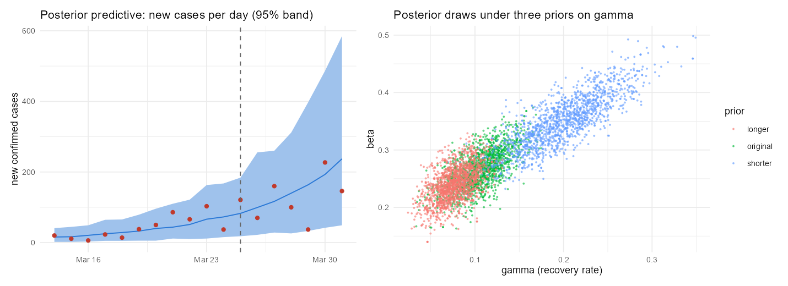

# Bayesian SIR inference on India's first COVID-19 cases

A Bayesian fit of an SIR epidemic model to India's daily confirmed COVID-19 cases from 14 to 31 March 2020, sampled
with adaptive Metropolis-Hastings. The main finding is about what these data can and cannot tell you: they pin down
how fast cases grew, but not R0.

This is a rebuild of a course project; [what the rebuild fixed](#what-the-rebuild-fixed) lists each change, and the
original script, report and slides are kept in [legacy/](legacy/).

## Results

Posterior means with 95% credible intervals, from [results/RESULTS.md](results/RESULTS.md):

| Prior on the recovery rate γ | Growth rate per day | Doubling time | R0 |
|---|---|---|---|
| N(0.10, 0.025²), the original (10-day infectious period) | 0.161 [0.112, 0.211] | 4.4 days [3.3, 6.2] | 2.59 [1.88, 3.90] |
| N(0.20, 0.05²) (5 days) | 0.151 [0.102, 0.202] | 4.7 days [3.4, 6.8] | 1.81 [1.43, 2.50] |
| N(0.07, 0.02²) (14 days) | 0.164 [0.117, 0.216] | 4.3 days [3.2, 5.9] | 3.30 [2.23, 5.43] |

- **Cases grew about 16% a day, doubling every 4.4 days**, whichever prior is used.
- **R0 is not identified by these data.** Early in an epidemic cases grow at rate β − γ, so the data fix that
  difference and the posterior lies along a ridge. Where on the ridge it sits, and so R0 = β/γ, follows the assumed
  infectious period: 1.8 for 5 days, 2.6 for 10, 3.3 for 14. The posterior infectious period stays close to each
  prior's mean.
- **The sampler converged:** 4 chains, R-hat at most 1.003 and an effective sample size of at least 3,100 for every
  parameter. All 18 observed days fall inside the 95% posterior predictive band.



*Left: observed new cases (red) and the 95% posterior predictive band; the dashed line is the national lockdown on
25 March. Right: posterior draws of (γ, β) under the three priors, sliding along the same ridge.*

## What the rebuild fixed

| Original script | Now |
|---|---|
| The case series was described as real Indian data but cited no source, and it does not match the Johns Hopkins counts (it rises smoothly from 3 to 197 a day; the reported counts run from 20 to 227 with large day-to-day swings). | Johns Hopkins CSSE daily counts, in [data/](data/), with the source. |
| Initial infections were fixed at 3, so the level of the case counts helped pin β, and R0 came out narrow. | Initial infections are estimated. |
| A Gaussian likelihood with a fixed standard deviation of 8 cases. | A negative-binomial likelihood with estimated dispersion, for lumpy daily reports. |
| One random-walk chain in (β, γ): effective sample size 18-19 out of 30,000 kept draws. | Sampling in (growth rate, log γ), with the proposal adapted during burn-in; 4 chains with R-hat and effective sample size. |
| R0 = 2.72 and a 5.75-day infectious period were reported as estimates. | The growth rate and doubling time are reported as the estimates, and R0 under three priors. |

## Method

- **Model.** SIR in a population of 1.38 billion; daily new cases are the fall in susceptibles each day. Parameters:
  transmission rate β, recovery rate γ, the number infectious on 13 March, and the negative-binomial dispersion.
- **Priors.** β ~ N(0.35, 0.08²), as in the original; γ under three priors (above); R0 restricted to [1, 8];
  weakly informative log-normal priors on initial infections and dispersion.
- **Sampler.** Adaptive Metropolis-Hastings (Haario et al., 2001) on (β − γ, log γ, log initial infections, log
  dispersion): 4 chains of 20,000 iterations, the first 8,000 discarded and the proposal frozen after them.
- **Checks.** Gelman-Rubin R-hat and effective sample size (coda); a posterior predictive check over 500 draws.

## Run it

R 4.5 with deSolve, coda, ggplot2 and patchwork:

```bash
Rscript covid_sir.R    # about 4 minutes on a laptop; writes results/RESULTS.md, results/summary.csv, results/fit.png
```

## Limitations

- Confirmed cases are not infections. Testing expanded during March 2020, which can make case growth look faster
  than infection growth.
- The national lockdown began on 25 March, inside the window. With a reporting lag of about a week, most cases
  counted here were infected before it, but the last days may already reflect it.
- SIR assumes homogeneous mixing across the whole country.
- Reported counts are lumpy (for example 37 on 29 March, then 227 on 30 March), which the negative-binomial likelihood
  absorbs as overdispersion rather than modelling.

## Data

Johns Hopkins University CSSE, COVID-19 Data Repository
(`csse_covid_19_time_series/time_series_covid19_confirmed_global.csv`), CC BY 4.0. Daily new cases are differences
of the cumulative series.
